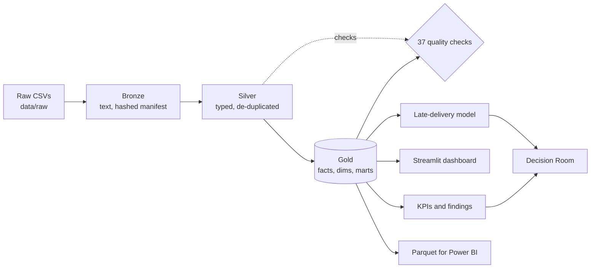

# SIGNALFORGE

**From Raw Data to Better Decisions.**

SIGNALFORGE is an end-to-end e-commerce intelligence platform: Data Engineering, Business Analysis, BI, Data Science and decision support in one reproducible, local-first system (Python, SQL, DuckDB, Parquet, scikit-learn, Streamlit).

 -green) 

> **Honest status.** The full pipeline runs end to end, but **only on a seeded synthetic dataset** that mimics the Olist table layout. The real Olist files could not be downloaded when this was built (see [docs/DATASET_SETUP.md](docs/DATASET_SETUP.md)). Every number produced from synthetic data describes the generator, not a real business, and the warehouse, report and dashboard label it as such. The GitHub repository is still named `DATASCOPE`; renaming it is a manual step (Settings > General > Repository name).

## The problem

Marketplace teams hold orders, payments, deliveries and reviews in separate tables. Headline numbers (revenue, order value, delivery performance) are often computed from inconsistent definitions, and dashboards rarely connect a finding to a defensible decision. SIGNALFORGE aims to show the full path: ingest raw data, validate it, model it, analyse it, visualise it, predict with it, and turn the result into decisions whose evidence and assumptions are explicit.

**Intended users:** marketplace and e-commerce analysts, operations and category managers, and data teams who need a reproducible reference for definitions, models and decision support.

## Five disciplines, one system

| Discipline | What exists today | Status |
|---|---|---|
| **Data Engineering** | Bronze (raw text + hash manifest) -> Silver (typed) -> Gold (star schema) in DuckDB, Parquet export, 37 quality checks, atomic builds | Implemented |
| **Business Analytics** | Single-definition KPIs, breakdowns, cohorts, findings report with definition / period / n / limitation, independent reconciliation | Implemented |
| **Business Intelligence** | Streamlit dashboard (5 views + definitions); Power BI handoff docs | Dashboard implemented; no `.pbix` |
| **Machine Learning** | Late-delivery risk model: purchase-time features, chronological split, baselines, calibration, segment errors | Implemented (synthetic data only) |
| **Decision Intelligence** | Decision Room: held-out evidence vs assumption-based what-ifs, no invented costs | Implemented |

## Architecture



Details: [docs/ARCHITECTURE.md](docs/ARCHITECTURE.md), [docs/DATA_MODEL.md](docs/DATA_MODEL.md), [docs/BUSINESS_METRICS.md](docs/BUSINESS_METRICS.md), [docs/DECISION_METHODOLOGY.md](docs/DECISION_METHODOLOGY.md).

## Getting started

```bash
git clone https://github.com/musab-abukaraki-66/DATASCOPE.git && cd DATASCOPE
python -m venv .venv && source .venv/bin/activate     # Windows: .venv\Scripts\activate
python -m pip install -e ".[dev]"
cp configs/project.example.yaml configs/project.yaml  # optional; the example works as-is
```

### Data

No data is committed. For the real Olist dataset follow [docs/DATASET_SETUP.md](docs/DATASET_SETUP.md) (check its licence yourself). To try the platform now, generate **synthetic** data:

```bash
signalforge demo-data      # writes invented Olist-style CSVs to data/raw
```

### Run the pipeline

```bash
signalforge build          # raw -> bronze/silver/gold + quality checks (fails loudly on bad input)
signalforge reconcile      # gold KPIs vs an independent pandas calculation
signalforge report         # data/processed/reports/findings.md
signalforge train          # late-delivery model, metrics, metadata
signalforge dashboard      # Streamlit app
```

### Tests and quality checks

```bash
pytest
ruff check . && ruff format --check .
```

## The model and its limits

Target: delivered later than the estimated date. Prediction time: order placement; delivery timestamps, review data and approval time are excluded as post-outcome. Train/validation/test are chronological (60/20/20), preprocessing is fitted on train only, the threshold is chosen on validation, and results are compared with a base-rate baseline and a cross-state rule. On the synthetic holdout the model is only modestly better than the baseline (PR-AUC 0.134 vs 0.116); this is reported as is. Only delivered orders have a label, which biases the latest period.

## Repository structure

| Path | Purpose |
|---|---|
| `src/signalforge/` | `ingestion`, `quality`, `transformations`, `analytics`, `models`, `decision_engine`, `dashboard`, `demo`, `cli.py` |
| `sql/silver`, `sql/gold` | All transformation logic in SQL; grain stated per table |
| `data/` | `raw`, `interim`, `processed` (git-ignored) |
| `dashboards/power-bi/` | Power BI handoff (model, DAX measures, page plan) |
| `docs/` | Architecture, model, metrics, methodology, dataset setup, roadmap, execution status |
| `tests/` | Unit and integration tests (synthetic fixtures, no download needed) |

## Limitations

- Not yet run on real data; schema assumptions are unconfirmed until then.
- GMV is item price only. Revenue, profit and costs are absent, so no ROI is computed anywhere.
- Findings are associations, never causal claims.
- No `.pbix`; no screenshots are committed.

## Roadmap and contributing

Milestones are tracked in [docs/ROADMAP.md](docs/ROADMAP.md); handoff state is in [docs/EXECUTION_STATUS.md](docs/EXECUTION_STATUS.md). Contribution guidance is in [CONTRIBUTING.md](CONTRIBUTING.md).

## License

[MIT](LICENSE). The licence of any dataset used is separate; see [docs/DATASET_SETUP.md](docs/DATASET_SETUP.md).
