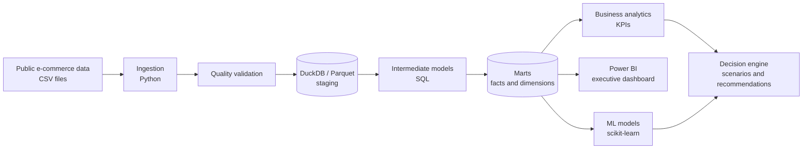

# DataScope

**From Raw Data to Real Decisions.**

DataScope is an end-to-end commerce intelligence platform that combines Data Engineering, Business Analytics, Business Intelligence, Machine Learning and Decision Intelligence in one reproducible system. The first business domain is e-commerce and marketplace analytics.

  

> **Status: repository foundation (milestone 1).** Only the project skeleton, configuration loader, tests and CI exist today. Everything marked *planned* below is not implemented. See [docs/ROADMAP.md](docs/ROADMAP.md).

## The problem

Marketplace teams hold orders, payments, deliveries and reviews in separate tables. Headline numbers (revenue, order value, delivery performance) are often computed from inconsistent definitions, and dashboards rarely connect a finding to a defensible decision. DataScope aims to show the full path: ingest raw data, validate it, model it, analyse it, visualise it, predict with it, and turn the result into decisions whose evidence and assumptions are explicit.

**Intended users:** marketplace and e-commerce analysts, operations and category managers, and data teams who need a reproducible reference for definitions, models and decision support.

## Five disciplines, one system

| Discipline | What it contributes | Status |
|---|---|---|
| **Data Engineering** | Reproducible ingestion, data-quality checks, layered SQL models | Planned |
| **Business Analytics** | Validated KPIs and root-cause analysis with documented definitions | Planned |
| **Business Intelligence** | Executive Power BI dashboard over the modelled marts | Planned |
| **Machine Learning** | Predictive models with proper evaluation and leakage control | Planned |
| **Decision Intelligence** | Recommendations and scenario analysis, separating fact, forecast and assumption | Planned |

## Architecture (conceptual)



Details: [docs/ARCHITECTURE.md](docs/ARCHITECTURE.md).

## Proposed stack

These are architectural choices, not all implemented or configured yet.

| Component | Role | Why | Status |
|---|---|---|---|
| Python | Orchestration, ingestion, quality, ML | Standard for data work | In use (config, tests) |
| DuckDB | Analytical SQL over local files and Parquet | Fast, zero-server, reproducible | In use (smoke test) |
| pandas + PyArrow | Dataframes and Parquet I/O | Interoperability with DuckDB and ML | Optional extra `data` |
| PostgreSQL | Possible later database integration | Realistic deployment target | Planned, optional |
| dbt | Modular transformations and data tests | Lineage and testable SQL | Planned (stage 2) |
| scikit-learn | Machine learning | Transparent, well-understood baselines | Optional extra `ml` |
| MLflow | Experiment tracking | Comparable, reproducible runs | Planned |
| Power BI | Executive BI experience | Common enterprise BI tool | Planned |

No paid API or distributed infrastructure is required.

## Capabilities

Implemented now:

- Installable Python package `datascope` with typed config loading (`datascope.config`) and an environment override.
- Unit and integration smoke tests, Ruff lint and format checks, GitHub Actions CI.

Planned (not implemented): ingestion and quality validation, staging models and warehouse, KPI validation, Power BI dashboard, predictive models, decision engine and scenario analysis.

## Getting started

Requires Python 3.11 or newer.

```bash
git clone https://github.com/musab-abukaraki-66/DATASCOPE.git
cd DATASCOPE
python -m venv .venv
# Windows: .venv\Scripts\activate    macOS/Linux: source .venv/bin/activate
python -m pip install -e ".[dev]"
cp configs/project.example.yaml configs/project.yaml
```

### Data

No data is committed. The planned first dataset is the Brazilian Olist e-commerce dataset on Kaggle. Download steps and licensing notes are in [docs/DATASET_SETUP.md](docs/DATASET_SETUP.md); files go in `data/raw/` (git-ignored).

### Tests and quality checks

```bash
pytest
ruff check .
ruff format --check .
```

## Repository structure

| Path | Purpose |
|---|---|
| `src/datascope/` | Python package: `ingestion`, `quality`, `transformations`, `analytics`, `models`, `decision_engine` |
| `sql/` | Layered SQL: `staging`, `intermediate`, `marts` |
| `data/` | `raw`, `interim`, `processed` (contents git-ignored) |
| `dashboards/power-bi/` | Power BI project (planned) |
| `docs/` | Product brief, architecture, data model, metrics, methodology, dataset setup, roadmap |
| `notebooks/`, `reports/`, `scripts/` | Exploration, written findings, helper scripts |
| `tests/` | `unit` and `integration` tests |
| `configs/` | Example project configuration |

## Roadmap and contributing

Eight verifiable milestones are defined in [docs/ROADMAP.md](docs/ROADMAP.md). Contribution guidance is in [CONTRIBUTING.md](CONTRIBUTING.md).

## License

[MIT](LICENSE). The licence of any dataset used is separate; see [docs/DATASET_SETUP.md](docs/DATASET_SETUP.md).
