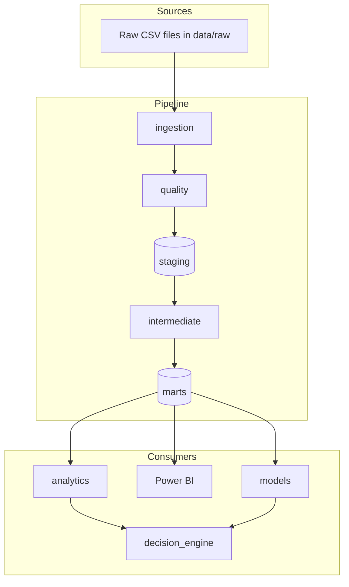

# Architecture

> Proposed design. Only configuration loading, the package skeleton, tests and CI are implemented.

## Data flow

## Components

| Component | Responsibility | Location |
|---|---|---|
| Ingestion | Read raw files, record file hashes and row counts, write to the staging layer without altering values | `src/datascope/ingestion` |
| Quality | Schema, null, uniqueness, referential and range checks; fail loudly with a report | `src/datascope/quality` |
| Transformations | Orchestrate layered SQL; keep logic in SQL, not Python | `src/datascope/transformations`, `sql/` |
| Analytics | KPI computation and validation against independent calculations | `src/datascope/analytics` |
| Models | Feature building, training, evaluation (time-aware splits, baselines) | `src/datascope/models` |
| Decision engine | Scenario analysis and recommendation records that carry evidence and assumptions | `src/datascope/decision_engine` |
| Dashboard | Executive Power BI report over the marts | `dashboards/power-bi` |

## Layers

- **staging:** one model per source table; types cast, names standardised, no business logic.
- **intermediate:** joins and derived fields (for example delivery delay), still at an explicit grain.
- **marts:** analytics-ready facts and dimensions; the only layer BI and models read.

## Design decisions

1. **DuckDB first.** Local, serverless, fast on Parquet. PostgreSQL stays optional so the project runs without infrastructure.
2. **SQL for transformations.** Business logic is reviewable and portable to dbt in the next stage.
3. **Raw data is immutable.** Every later layer is rebuildable from `data/raw`.
4. **Definitions are documents.** Metrics are defined in [BUSINESS_METRICS.md](BUSINESS_METRICS.md) before they are coded.
5. **Reproducibility over cleverness.** Pinned config, deterministic seeds, tests in CI.
6. **Data never enters git.** Only code, SQL, docs and small test fixtures.
