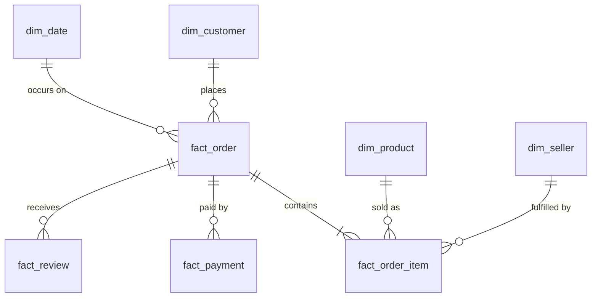

# Analytical data model (proposed)

A dimensional model for marketplace analytics. Field names below are design intent; they are confirmed against the real tables in milestone 2.

## Facts

| Fact | Grain | Key measures | Notes |
|---|---|---|---|
| `fact_order_item` | one row per item in an order | item price, freight value | Core sales fact; revenue-like measures start here |
| `fact_order` | one row per order | item count, order status, purchase / approval / carrier / delivery / estimated-delivery timestamps | Delivery timeliness lives here |
| `fact_payment` | one row per payment installment record of an order | payment type, installments, payment value | An order can have several payment rows |
| `fact_review` | one row per review | review score, review dates | An order may have more than one review; define the rule for which counts |

## Dimensions

| Dimension | Description |
|---|---|
| `dim_customer` | Customer identity and location. Distinguish the per-order customer id from the persistent customer id when the source provides both |
| `dim_product` | Product attributes and category (with English translation) |
| `dim_seller` | Seller identity and location |
| `dim_date` | Calendar dimension for all event dates |
| `dim_geography` | Location reference (from postal prefixes) |

## Relationships

## Modelling rules

- State the grain of every table in its first comment.
- Never sum a measure across a join that changes its grain (for example payments joined to items).
- Keep source values in staging; derive in intermediate; expose only marts to BI and models.
- Test keys: uniqueness at the stated grain and referential integrity between facts and dimensions.
